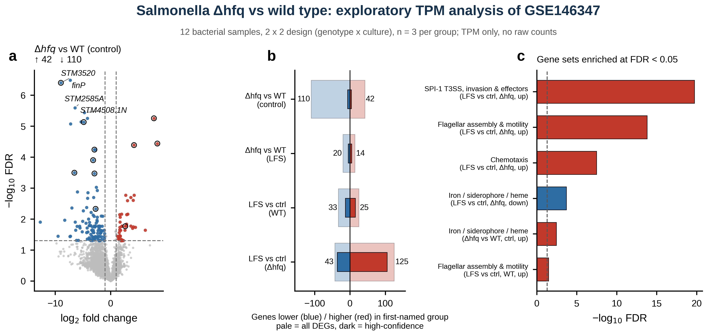
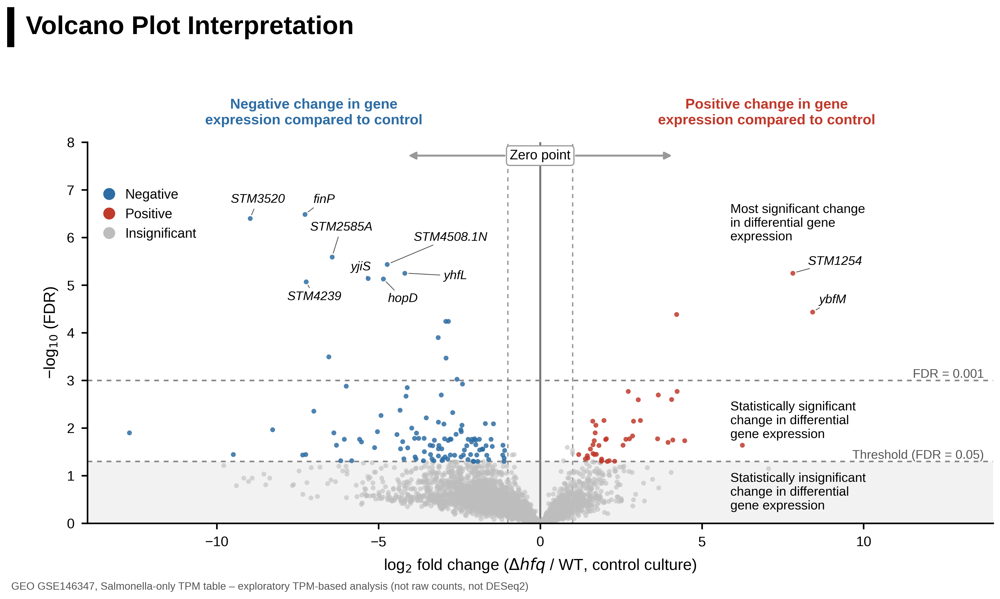
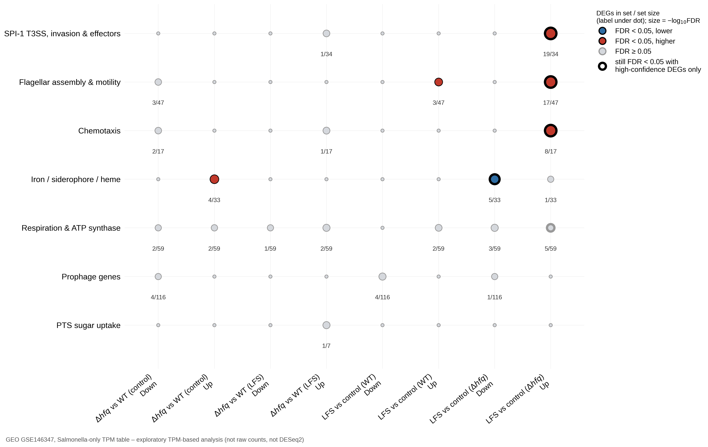

# Salmonella Typhimurium Δ*hfq* transcriptome: exploratory analysis of GEO GSE146347

[](https://github.com/hammad202204168-ui/RNA-Seq-Differential-Expression-PPI-Hub-Gene-Structure-Analysis-Salmonella-GEO-GSE146347-/actions)
[](LICENSE)


-orange)

> [!IMPORTANT]
> **Only TPM values were available** (the GEO supplementary table), not raw counts. DESeq2/edgeR therefore could **not** be used. Statistics are pooled-variance *t*-tests on log2(TPM + 1) with Benjamini–Hochberg correction, and all results are **exploratory**. Several data-quality issues (see [Data problems](#data-problems-and-what-was-done-about-them)) were found and are reported, not hidden. A batch-aware count pipeline is prepared (see [`docs/BATCH_AND_COUNTS_PLAN.md`](docs/BATCH_AND_COUNTS_PLAN.md)) but **has not been run on real counts**: the meaning of `_2` and the SRA reads could not be obtained in the build environment.



## Data
| | |
|---|---|
| Study | Barrila *et al.* 2022, *Front Cell Infect Microbiol*, [doi:10.3389/fcimb.2022.705647](https://doi.org/10.3389/fcimb.2022.705647) |
| Accession | GEO [GSE146347](https://www.ncbi.nlm.nih.gov/geo/query/acc.cgi?acc=GSE146347); BioProject PRJNA610228; SRA SRP251525 |
| File analysed | `GSE146347_fpkm_TPM_salonly.txt.gz` (Salmonella-only; 4,743 genes; FPKM + TPM) |
| Design | *S.* Typhimurium χ3339 wild type vs Δ*hfq*, grown in a rotating-wall-vessel bioreactor in **control** or **low-fluid-shear (LFS)** orientation; **n = 3 per group, 12 samples** (the 60 human co-culture samples are not used) |
| Provenance details | [`data/source_accessions.csv`](data/source_accessions.csv) |

The TPM columns carry genotype and orientation in their names but **no GSM/SRR identifiers**, so individual columns are not linked to individual runs; only the group structure (3/3/3/3, confirmed against the SRA run table) is.

## Key observations (exploratory)
Genes tested = 4,420 (TPM ≥ 1 in ≥ 3 samples, rRNA/tRNA/ncRNA excluded). **DEG** = FDR < 0.05 and |log2FC| ≥ 1. **High-confidence DEG** = a DEG that is not expressed in only one group, has TPM ≥ 1 in all three replicates (mean ≥ 5) of its higher group, and keeps its direction (FDR < 0.05, |log2FC| ≥ 1) after adjusting for per-sample gene-detection rate ([robustness checks](#data-problems-and-what-was-done-about-them)).

| Contrast | DEGs up / down | High-confidence up / down |
|---|---:|---:|
| Δ*hfq* vs WT, control culture | 42 / 110 | 4 / 7 |
| Δ*hfq* vs WT, LFS culture | 14 / 20 | 5 / 5 |
| LFS vs control, WT | 25 / 33 | 15 / 13 |
| **LFS vs control, Δ*hfq*** | **125 / 43** | **105 / 36** |

1. **The low-fluid-shear (LFS) response inside Δ*hfq* is the one robust result:** 141 of its 168 DEGs (84 %) are high-confidence. Genes higher under LFS are enriched for SPI-1 type III secretion/invasion genes (18/34 high-confidence DEGs), flagellar genes (16/47) and chemotaxis genes (7/17), all FDR < 0.001; iron/siderophore genes are lower (5/33, FDR 2 × 10⁻⁴). The enrichment persists when only high-confidence DEGs are used. A co-expression module of these DEGs has hubs *flgG, flgL, cheA, fliB, sicA* (descriptive; not a protein-interaction network).
2. **Δ*hfq*-vs-WT differences cannot be reliably separated from technical confounding in this dataset.** Only 11 of 152 control-culture DEGs (7 %) and 10 of 34 LFS-culture DEGs are high-confidence. Genotype is nearly collinear with rRNA content, gene-detection rate and the `_2` sample-name suffix (see below), so covariate adjustment also removes real signal: even the deleted gene *hfq* (log2FC −8.3; ~773 → ~5 TPM, FDR 0.011, a valid positive control) fails the adjusted check. These contrasts are therefore **inconclusive**, not shown to be false.
3. The LFS effect in wild type is smaller (58 DEGs; 28 high-confidence; flagellar genes modestly enriched, 3/47, FDR 0.033).

| Volcano interpretation (primary contrast) | Gene-set enrichment |
|---|---|
|  |  |

## Data problems and what was done about them
The data have four problems that no analysis can remove; the pipeline flags them, tests how much of each result depends on them, and reports the surviving high-confidence set ([Fig 13](results/figures/Fig13_robustness_checks.png), `results/tables/robustness_summary.csv`).

| Problem | Evidence | Mitigation in the pipeline | What remains |
|---|---|---|---|
| **Unequal rRNA depletion** | rRNA = 0–0.1 % of TPM in WT-LFS, 3–5 % in WT-control, 8–24 % in Δ*hfq* ([Fig 2d](results/figures/Fig2_quality_control.png)) | rRNA/tRNA/ncRNA genes removed and TPM renormalised; rRNA-share covariate model as a sensitivity check | Library-prep differences confounded with genotype; only 6 % of control-culture DEGs survive rRNA adjustment |
| **Shallow, uneven depth** | SRA run table, group level: Δ*hfq* ≈ 41–96 Mb (median 78 Mb) vs WT-LFS median 385 Mb; Δ*hfq* detect ~3,000–3,800 genes vs ~4,200+ in WT | Detected-genes covariate (used in the high-confidence definition); "consistent detection" rule against dropout | Cannot be undone without raw counts; low-expression calls remain fragile |
| **Possible library batch** | 5 of 6 Δ*hfq* sample names end in `_2`, no WT name does; **PC1 (41 %) is explained better by `_2` (η² 0.74) than by genotype (0.63)**, and the one Δ*hfq* sample without `_2` sits with the wild type | `_2`-suffix covariate model as a sensitivity check (ill-conditioned: the batch is estimable from one sample) | Genotype and batch cannot be separated; the meaning of `_2` is undocumented in the files supplied |
| **WT-control-only genes** | 9 tested genes are expressed (≥ 5 TPM) only in WT-control and < 1 TPM in all nine other samples; they make up 9 of the 152 control-culture DEGs and 9 of the 20 genotype × culture interaction hits ([`group_exclusive_genes.csv`](results/tables/group_exclusive_genes.csv)) | Flagged (†) in tables and heatmap; the model is refit without them; they can never be high-confidence | Their biological or technical origin is unknown |

Further limitations:
* **TPM only, no raw counts:** no DESeq2/edgeR, no variance moderation; p-values come from ordinary *t*-tests (8 df, 7 with a covariate).
* **Sample columns are not linked to individual GSM/SRR runs**, only to groups (3/3/3/3, matching the SRA table).
* **Reference mismatch:** genes are annotated on *S.* Typhimurium LT2 (NC_003197.1, pSLT NC_003277.1); the strain is χ3339, an SL1344 derivative.
* **Gene-set enrichment is rule-based** (gene-name prefixes and annotation keywords, [`gene_set_membership.csv`](results/tables/gene_set_membership.csv)), not GO/KEGG; sets overlap and are imperfect.
* n = 3 per group; findings need experimental confirmation.

## Reproduce
```bash
git clone https://github.com/hammad202204168-ui/RNA-Seq-Differential-Expression-PPI-Hub-Gene-Structure-Analysis-Salmonella-GEO-GSE146347-.git
cd RNA-Seq-Differential-Expression-PPI-Hub-Gene-Structure-Analysis-Salmonella-GEO-GSE146347-
python -m venv .venv && source .venv/bin/activate   # Windows: .venv\Scripts\activate
pip install -r requirements.txt
make run      # parse GEO table -> data/processed/, statistics + Fig0-13 + tables in results/
make ppi      # STRING hubs + AlphaFold summary -> Fig14-16
make test     # rebuilds everything and runs pytest (28 tests)
```
Without `make`: `python scripts/prepare_geo_tpm.py && python scripts/real_data_analysis.py && pytest -q`.

See [`docs/WORKFLOW.md`](docs/WORKFLOW.md) for the step-by-step workflow, which tool was used at each step, and which steps were done manually (GEO, STRING, UniProt and AlphaFold DB downloads).

## Repository layout
```
.
├── README.md  LICENSE  CITATION.cff  CHANGELOG.md  CONTRIBUTING.md
├── Makefile  requirements.txt  pytest.ini  .gitignore
├── .github/               CI workflow (pipeline.yml) and issue templates
├── data/                  see data/README.md
│   ├── raw/               GEO supplementary TPM table
│   ├── sra/               SRA run table, bacterial SRR list
│   ├── processed/         TPM matrix, annotation, metadata (generated)
│   ├── string/            STRING exports + UniProt ID mapping
│   ├── alphafold/         14 AlphaFold DB v6 models
│   └── source_accessions.csv   provenance and verification status
├── scripts/               prepare_geo_tpm.py, real_data_analysis.py, robustness.py, ppi_hubs_structures.py,
│                          plotstyle.py, volcano_guide.py, collect_batch_evidence.py, rebuild_counts_from_sra.sh,
│                          featurecounts_to_matrix.py, batch_aware_de.py, simulate_validation.py,
│                          render_alphafold_cartoons.pml/.cxc
├── results/               see results/README.md (figures/, tables/, structures/)
├── docs/                  WORKFLOW.md, METHODS.md, FIGURES.md, BATCH_AND_COUNTS_PLAN.md
├── tests/                 pytest regression tests
└── examples/demo_30gene/  earlier 30-gene SIMULATION demo (PyDESeq2, synthetic BAMs); not real data
```

## Figures
See [docs/FIGURES.md](docs/FIGURES.md) for legends. Fig1 workflow · Fig2 QC · Fig3 PCA and sample distances (after Fig. 5 of Batut *et al.* 2021) · Fig4 *hfq* control and top genes · Fig5 heatmap + volcano (after Fig. 6) · **Fig6 annotated volcano interpretation chart** · Fig7 volcanoes for all four contrasts · Fig8 p-value histograms and MA plots · Fig9 LFS effect by genotype · Fig10 enrichment · Fig11 co-expression network · Fig12 schematic volcano reading guide (simulated points) · **Fig13 robustness checks** · Fig14 STRING PPI network · Fig15 AlphaFold hub structures · Fig16 pLDDT bands.

## PPI network and hub genes (STRING, real export) and predicted structures (pending)
Input: the 141 high-confidence LFS-in-Δhfq DEGs. Network: STRING web export at combined score ≥ 0.7 (`data/string/`, minimum score in the file 0.701), *S.* Typhimurium LT2. Run: `python scripts/ppi_hubs_structures.py --string_edges data/string/string_interactions_short_135_nodes.tsv --string_annotations data/string/string_protein_annotations_135_nodes.tsv --skip_structures`. Outputs: `results/tables/ppi_*.csv`; `results/figures/Fig14_PPI_network_STRING.{png,pdf,svg}` (double-column 7.2 in, 600 dpi PNG; PDF/SVG keep editable text; Okabe-Ito colours; edges coloured by whether they survive removal of text-mining evidence). Node labels in dense regions may need manual nudging in Inkscape/Illustrator; the font is DejaVu Sans.

* STRING matched 135/141 genes (6 not found: STM3520, STM05625, PSLT050.1N, trbH, pefI, PSLT020). Six matched only through aliases (e.g. our *spaN* is STRING's *invJ*). 348 edges; 88 genes connected, 47 without a partner. One component of 44 genes joins SPI-1 type III secretion (*inv, prg, sip, sic, hil, sop*) with flagella/chemotaxis (*fli, flg, che*); all 44 are up in LFS. 14 small components follow, several of them down-regulated (e.g. iron-uptake genes *fepA/fhuA/cirA*).
* Top 10 by degree/weighted degree/betweenness: *fliC, invA, fliA, spaO, prgH, cheA, sipA, invJ (=spaN), fliD, prgI*. Degrees are close (17-26) and ranks 8-14 are ties, so "top 10" is not a sharp boundary.
* **Hubs depend on the evidence type.** Of 348 edges, 280 have text-mining support and 278 co-expression support (channel score ≥ 0.4), but only 38 experimental and 26 curated-database support. Without text-mining the hubs become *prgH, fliA, flgC, flgL, fliD, invJ, invG, prgI, flgD, invE*; only *fliA, prgH, invJ, fliD, prgI* stay in the top 10 in every variant (`stable_hub`). *fliC* and *invA* do not.
* Overlap with the co-expression hubs: only *cheA* is in the PPI top 10; *flgG, flgL, sicA* sit in the degree plateau, *fliB* is peripheral (degree 4).
* Limits: STRING associations are not proof of binding; the motility and SPI-1 genes are densely annotated in STRING, which favours them as hubs; the DEG list itself is exploratory (TPM-based, genotype confounded with `_2`).

Structures (real AlphaFold DB v6 models, `data/alphafold/`) for 14 targets (top 10 + stable hubs + co-expression hubs). UniProt accessions come from a UniProt ID-mapping export (`data/string/uniprot_idmapping_hub_genes.tsv`; all 14 mapped one-to-one to reviewed LT2 entries; `results/tables/hub_uniprot_ids.csv`). Run: `python scripts/ppi_hubs_structures.py --string_edges data/string/string_interactions_short_135_nodes.tsv --string_annotations data/string/string_protein_annotations_135_nodes.tsv --uniprot_map data/string/uniprot_idmapping_hub_genes.tsv --structures_dir data/alphafold` -> `results/tables/hub_structures.csv`, `Fig15` (C-alpha traces, schematic), `Fig16` (pLDDT bands, png/pdf/svg). Checks: residue counts equal UniProt lengths for all 14; fliC mean pLDDT 93.4 matches the AlphaFold DB page (93.38).

* High confidence (mean pLDDT ≥ 90): *fliD* 94.4, *flgL* 93.8, *fliC* 93.4, *sicA* 93.2, *fliB* 92.5. Intermediate: *prgI* 88.6, *invA* 87.9, *flgG* 86.5, *spaO* 82.9, *cheA* 79.8, *fliA* 78.9, *prgH* 76.4. **Low: *sipA* 62.0 (49 % of residues < 70) and *invJ*/*spaN* 44.9 (90.5 % < 70)**: these models should not be interpreted structurally (likely largely flexible or disordered in isolation, or dependent on partners).
* These are predicted monomers. They do not model the assembled filament, hook, needle or injectisome, and high confidence does not mean the complex is right. pLDDT is not a measure of function or of importance as a hub. For fliC, 11 experimental PDB structures exist (per the AlphaFold DB page); prefer experimental structures where they exist.
* `scripts/render_alphafold_cartoons.pml` / `.cxc` render cartoon images coloured by pLDDT from the same files (PyMOL / ChimeraX); **not tested** here.

## Next step for publication-grade results
Prepared, not yet run on real data (details, validation on simulated counts and the decision table: [`docs/BATCH_AND_COUNTS_PLAN.md`](docs/BATCH_AND_COUNTS_PLAN.md)):
1. `scripts/collect_batch_evidence.py` links each TPM column to its GSM/SRR and collects what GEO, ENA and the read headers say about `_2` (needs internet). If they are silent, ask the authors.
2. `scripts/rebuild_counts_from_sra.sh` + `scripts/featurecounts_to_matrix.py` rebuild raw counts (LT2 as published; repeat with an SL1344-type reference to test reference-driven dropout).
3. `scripts/batch_aware_de.py` fits `~ group` and `~ batch + group` (PyDESeq2), reports which hits survive, and diagnoses dropout (depth-limited vs not explained by depth, with 95 % upper detection limits).

What this can and cannot give: with `_2` as batch, the Δhfq-vs-WT contrasts keep an effective n of about 1-1.5 per group (`results/tables/design_identifiability.csv`), so genotype and batch stay largely inseparable whatever the counts show; the LFS-within-genotype contrasts are barely affected.

## Citation
Cite this repository ([CITATION.cff](CITATION.cff)) **and** the source: Barrila J *et al.* (2022) Front Cell Infect Microbiol, doi:10.3389/fcimb.2022.705647; GEO GSE146347. Batut B *et al.* (2021) *Methods Mol Biol* 2284:367–392 inspired the workflow and figure layouts.

MIT License. Author: Hammad Anwar.
