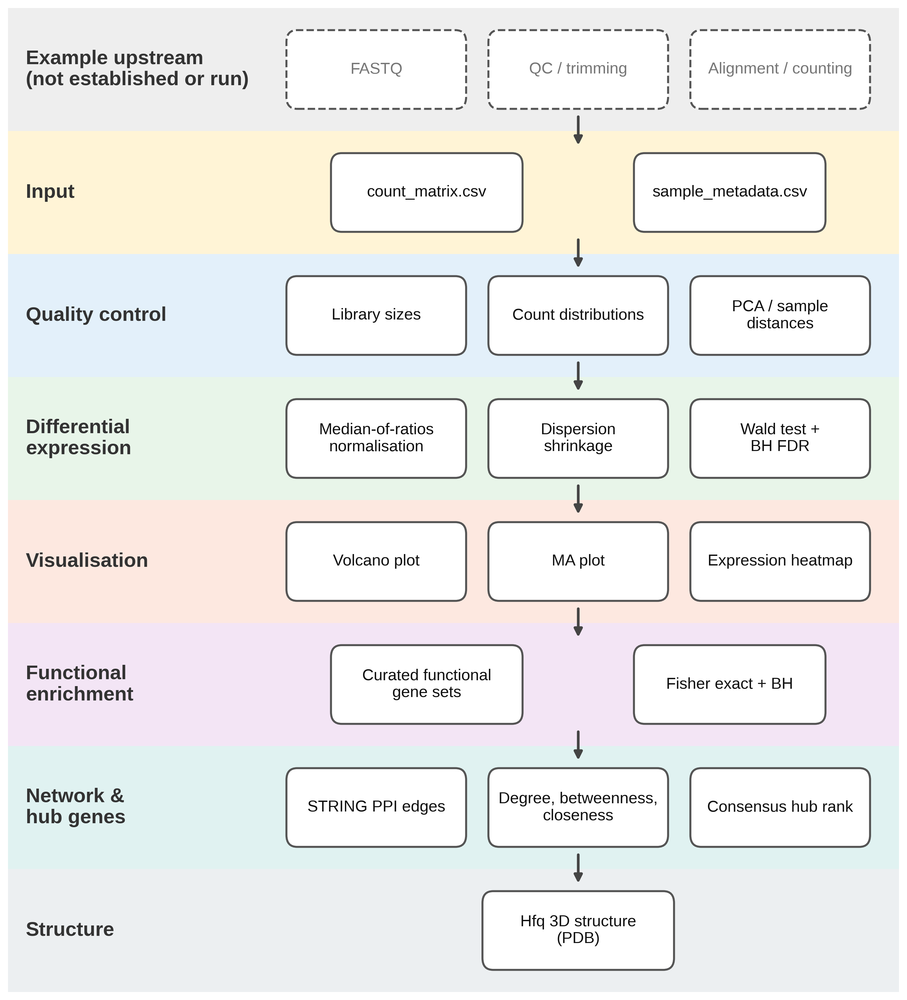
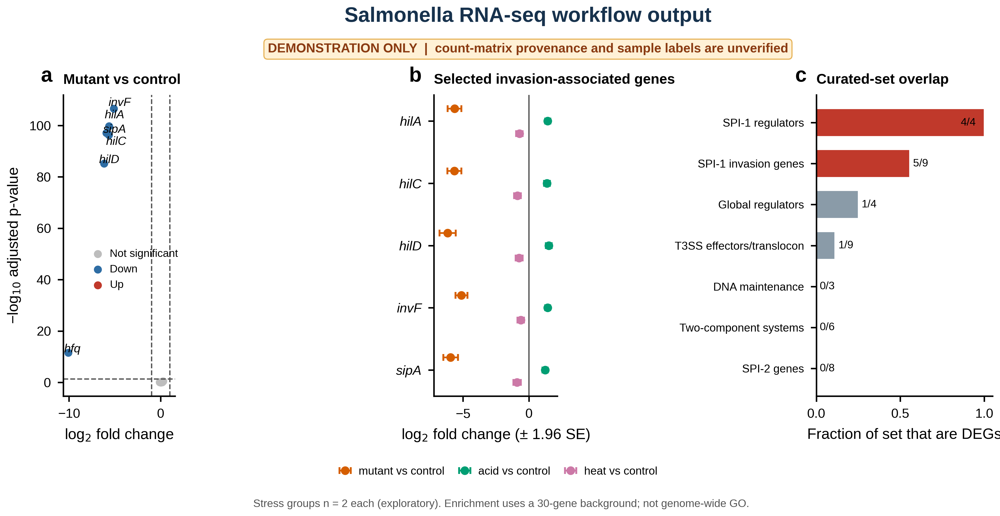
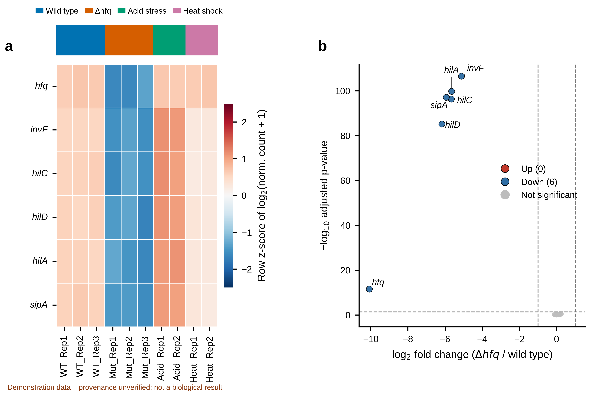
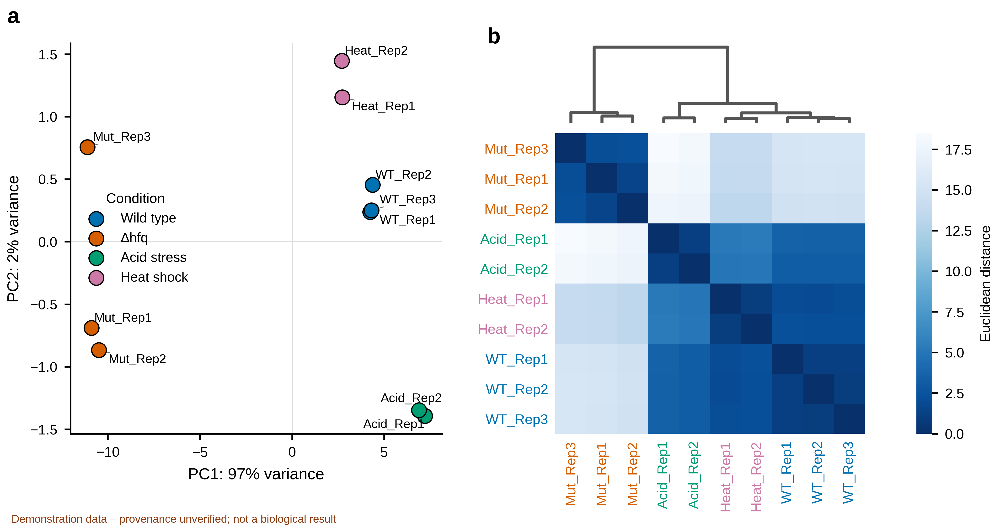
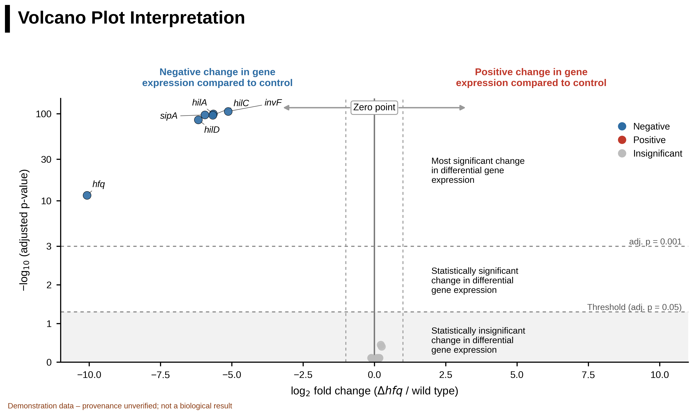
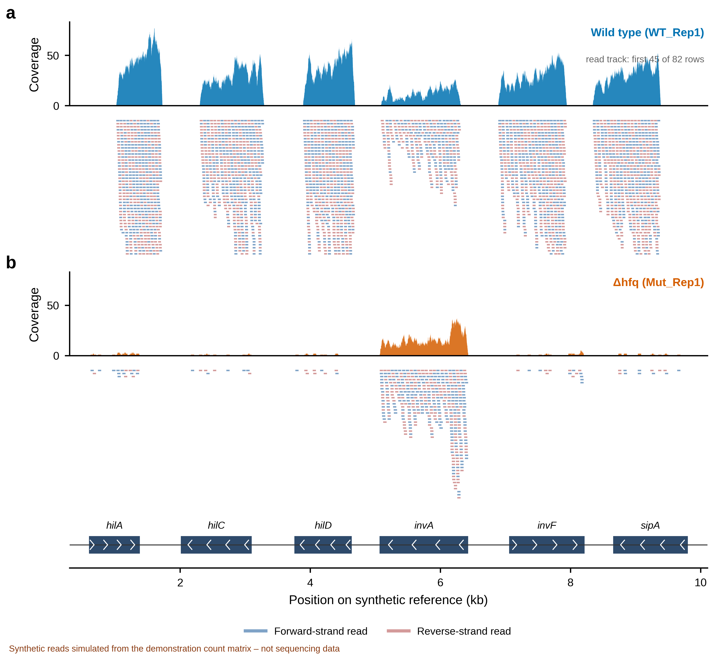

# Salmonella Typhimurium RNA-seq demonstration pipeline (30-gene simulation)

> **This folder is an earlier software demonstration on an unverified 30-gene matrix. The real-data analysis of GEO GSE146347 is in the repository root.**

[](LICENSE)


> [!CAUTION]
> This repository is a **software demonstration, not a validated biological study**. The origin of the supplied 30-gene count matrix is not established. The previously listed GEO and SRA records were checked and are unrelated to the stated Salmonella experiment (the GEO series is human data; an alleged SRA run is mouse T-cell data). The results below are outputs from this unverified illustrative matrix and must not be cited as experimental findings. See [data/source_accessions.csv](data/source_accessions.csv), [docs/METHODS.md](docs/METHODS.md) and, for a real dataset, [docs/REAL_DATA_GUIDE.md](docs/REAL_DATA_GUIDE.md).





## Demonstration output
The supplied matrix yields six genes meeting the pipeline's illustrative differential-expression threshold in the mutant/control contrast. These numbers, enrichment p-values, and hubs are **not biological conclusions** because sample provenance and count-generation methods are unverified. The `hfq` count pattern is also not independent confirmation of a deletion experiment.

| Volcano + heatmap | PCA + sample distances |
|---|---|
|  |  |

## How to read the volcano plot


Figure legends and a short reading guide are in [docs/FIGURES.md](docs/FIGURES.md). A schematic with simulated points (Fig12) is also provided.

## Synthetic BAM files and alignment figures


No raw reads exist for this project, so `scripts/simulate_alignments.py` generates **synthetic** coordinate-sorted, indexed BAMs in `data/synthetic_alignments/`: single-end 50-nt reads simulated from the count matrix onto a random reference. Re-counting reads from the BAMs reproduces the matrix exactly (checked by the script and by tests). Fig13 and Fig14 follow Fig. 4 of Batut et al. (2021) but show simulated data only; the BAMs add no independent biological evidence. See [data/synthetic_alignments/README.md](data/synthetic_alignments/README.md).

## Figures (600 dpi PNG + vector PDF in `results/figures/`)
| File | Content |
|---|---|
| Fig0 | Graphical summary |
| Fig1 | Workflow overview |
| Fig2 | QC: library sizes, count distributions, mean-variance |
| Fig3 | PCA and clustered sample-distance heatmap |
| Fig4 | DESeq2 diagnostics: dispersion, p-value histogram, MA plot |
| Fig5 | DEG heatmap and volcano plot |
| Fig6 | Normalised counts of the top DEGs |
| Fig7 | log2FC of all genes across the three contrasts |
| Fig8 | Functional enrichment |
| Fig9 | PPI network and hub ranking |
| Fig10 | Hfq Cα trace (generated only when a validated Hfq PDB is in `structure/`) |
| Fig11 | Annotated volcano plot ("how to read it"), real contrast |
| Fig12 | Schematic volcano reading guide (simulated points) |
| Fig13 | IGV-style alignment view (coverage, reads, gene models) from the **synthetic** BAMs |
| Fig14 | Sashimi-style junction plot from a **synthetic** spliced toy locus |

## Run it
```bash
python -m pip install -r requirements.txt
python scripts/rna_seq_pipeline.py
python scripts/simulate_alignments.py   # synthetic BAMs
python scripts/plot_alignments.py       # Fig13, Fig14
python -m pip install pytest
python -m pytest -q
```
Figures and tables are regenerated in `results/`. The full network/structure refresh requires internet:

```bash
bash scripts/update_with_internet.sh
```

The script supports a `PYTHON` environment variable if the Python executable is not named `python`.

## Repository layout
```
data/      count matrix, synthetic_alignments/ (simulated BAMs), declared metadata, accession verification, STRING edges/provenance
scripts/   rna_seq_pipeline.py, geo_helper.py, simulate_alignments.py, plot_alignments.py, fetch_string_network.py, fetch_hfq_structure.py, update_with_internet.sh, set_author.py
results/   figures/, tables/
tests/     regression tests (run in CI)
docs/      METHODS.md, FIGURES.md (legends), REAL_DATA_GUIDE.md
structure/ Hfq structure (see structure/README.md)
```

## Data and provenance
The input is a **30-gene x 10-sample count matrix** (declared groups: WT n=3, mutant n=3, acid n=2, heat n=2). Its raw-data provenance and sample group assignments are unknown. Sequencing type and instrument are therefore recorded as unknown. It has flat wild-type mean counts (about 2-fold range; median about 409) and should only be used to exercise the software. The accession file records the verification outcome: GSE114853 is a human enteroendocrine-cell study; SRR7219922 is a mouse FoxP3+ regulatory T-cell study. Neither supports the stated Salmonella sample labels. NC_016810.1 is a valid SL1344 reference genome accession but does not establish where these counts came from. Do not substitute those unrelated records or represent this matrix as experimental raw-read-derived data.

**Verified real alternative:** GEO [GSE146347](https://www.ncbi.nlm.nih.gov/geo/query/acc.cgi?acc=GSE146347) (GeneLab GLDS-277; Barrila *et al.* 2022, [doi:10.3389/fcimb.2022.705647](https://doi.org/10.3389/fcimb.2022.705647)) is a real *S.* Typhimurium wild type vs Δ*hfq* RNA-seq study (LSMMG vs control culture, plus human host samples). Its existence was verified, but its counts were **not** retrieved and it is **not** the source of this matrix, which has no acid-stress or heat-shock counterpart there. [docs/REAL_DATA_GUIDE.md](docs/REAL_DATA_GUIDE.md) lists the steps and code changes needed to analyse it; `scripts/geo_helper.py` lists its files and samples.

To make this a biological study, replace the matrix and metadata with counts generated from identified Salmonella raw reads, document run-to-condition mapping and processing (reference genome, annotation, aligner/quantifier, filtering, strandedness), then regenerate outputs and independently validate the design.

## Project status
| Item | Status |
|---|---|
| Pipeline and generated outputs | Runs and passes tests locally; GitHub Actions workflow included; demonstration only |
| Functional enrichment | Curated overlapping sets tested against only 30 genes; not genome-wide GO |
| STRING network | LT2 (taxon 99287) associations; not proof of direct interaction or Salmonella SL1344-specific evidence |
| Hfq structure | *E. coli* PDB 1HK9 homolog; not a Salmonella-specific structure |
| Biological input provenance | **Unverified; not ready for biological/publication claims** |
| Real-data path | GSE146347 identified and verified to exist; counts not yet imported (needs internet; see `docs/REAL_DATA_GUIDE.md`) |

## Citations
- Batut B. et al. (2021) RNA-Seq data analysis in Galaxy. *Methods Mol Biol* 2284:367-392.
- Love MI, Huber W, Anders S (2014) DESeq2. *Genome Biol* 15:550. [doi:10.1186/s13059-014-0550-8](https://doi.org/10.1186/s13059-014-0550-8).
- Muzellec B. et al. (2023) PyDESeq2: a python package for bulk RNA-seq differential expression analysis. *Bioinformatics* 39:btad547. [doi:10.1093/bioinformatics/btad547](https://doi.org/10.1093/bioinformatics/btad547).
- Szklarczyk D. et al. (2021) The STRING database in 2021. *Nucleic Acids Res* 49:D605-D612. [doi:10.1093/nar/gkaa1074](https://doi.org/10.1093/nar/gkaa1074).
- Sauter C, Basquin J, Suck D. (2003) SM-like proteins in Eubacteria: the crystal structure of the Hfq protein from *Escherichia coli*. *Nucleic Acids Res* 31(14):4091-4098. [doi:10.1093/nar/gkg480](https://doi.org/10.1093/nar/gkg480). PDB 1HK9 is an *E. coli* homolog structure, not a Salmonella structure.

MIT License.
